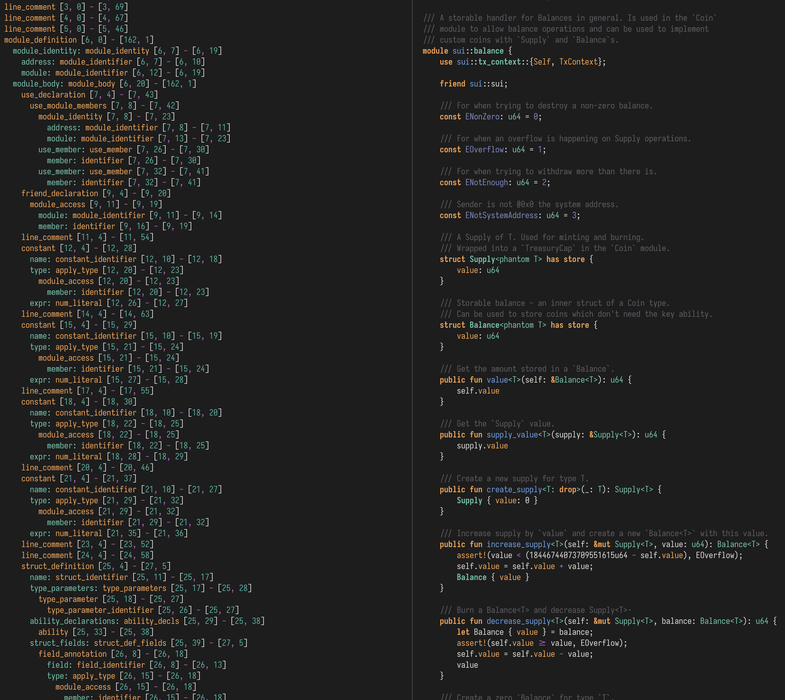

# Tree Sitter for Move

This is a Tree-sitter implementation for Sui Move, maintained as a standalone
fork of MystenLabs/sui's Move parser.

## Current Status

The grammar covers modules, enums, macros, patterns, specifications and legacy
address blocks. It includes editor queries and Node and Rust bindings.

In addition to whole files, the grammar parses the signature fragments that
the move-analyzer LSP renders in hover tooltips (qualified function/struct/enum
signatures, `let x: T` locals, bare types, and so on), so ` ```move ` code
fences in hover markdown highlight correctly without a wrapping module.

Upstream comparisons and parser improvements are tracked in the
[Linear project](https://linear.app/embe221ed/project/move-sui-parser-upstream-alignment-and-reliability-8da0b141d8c1).
The latest comparison uses MystenLabs/sui revision
[`2f3d66641ecff9ff653e032d521c5936fd298093`](https://github.com/MystenLabs/sui/tree/2f3d66641ecff9ff653e032d521c5936fd298093/external-crates/move/tooling/tree-sitter).
Expression type arguments follow the compiler's token adjacency rule:
`f<T>()` is a generic call, while a gap before `<` makes it a comparison.
Spaces, newlines and comments all count as gaps. Type annotations still allow
spaces before their type arguments.

## External Scanner

The grammar uses an external scanner (`src/scanner.c`) for:

- the contextual `vector` keyword that starts a vector literal (`vector[1, 2]`,
  `vector<u8>[]`, including the spaced forms `vector [1]` / `vector <u8> [1]`).
  Mirroring the Move compiler, `vector` only starts a literal when the next
  token is `[` or `<`; everywhere else it stays an ordinary identifier
  (`vector::empty()`, `use std::vector`).
- block comments, which nest in Move (`/* a /* b */ c */`) and therefore cannot
  be described by a regular-expression token.
- names immediately followed by `<` in expression positions. A stateless
  lookahead distinguishes generic arguments from comparisons while retaining
  comments and whitespace in the syntax tree.
- `///` doc comments, whose content is exposed as a `doc_comment` node for
  markdown injection (`////...` is a plain comment again, as in Rust).
- an error sentinel used to detect error-recovery states.

Any build of this parser must therefore compile **both** `src/parser.c` and
`src/scanner.c`. The tree-sitter CLI, `tree-sitter build --wasm`, and the
node-gyp binding pick the scanner up automatically. When building a shared
library by hand:

```sh
cc -shared -fPIC -O2 -I src src/parser.c src/scanner.c -o parser.so
```

## The tree-sitter CLI

`src/parser.c`, `src/grammar.json`, `src/node-types.json` and
`src/tree_sitter/` are generated and **committed**, so the CLI version matters:
an older one silently rewrites all four in an older format (Debian's
`tree-sitter-cli` is still 0.20.8, and it drops `grammar.json`'s `$schema` and
`reserved` keys). Nothing here uses a bare `tree-sitter` off `PATH` — the
version is pinned in `package.json` and everything resolves
`node_modules/.bin/tree-sitter`:

```sh
npm ci               # once; run-tests.sh does this if the local CLI is missing
npm run generate     # instead of a bare `tree-sitter generate`
```

The CLI and Rust test runtime are pinned to **0.27.1**. `run-tests.sh` refuses
to run if the resolved CLI is not the exact pinned version,
and `test/highlights/check.py` resolves the same binary. On a clean tree a
regeneration is a no-op; if it moves anything under `src/`, commit that along
with the `grammar.js` change that caused it.

`tree-sitter.json` carries the grammar metadata (scope, file types, query
paths) that used to live under package.json's `tree-sitter` key. Generation
explicitly selects **ABI 15** with `--abi 15`, independently of CLI defaults.
The grammar uses Tree-sitter's reserved-word support to reject unconditional
Move keywords in identifier positions while preserving escaped identifiers
and contextual names such as `vector`, `entry` and `spec`.

An earlier revision of this note claimed ABI 14 had to be kept for the
prettier-move plugin, which loads a Move grammar through `web-tree-sitter`
0.20.x. That does not apply here: prettier-move regenerates its wasm via
`scripts/treesitter-wasm-gen.sh`, which clones `tzakian/tree-sitter-move` — a
different upstream — and nothing in it reads this repo. This grammar has no
wasm build at all. If you ever do point that script here, pass `--abi 14`.

Consumers need a runtime that supports ABI 15. The native Node binding is tested
with `tree-sitter` 0.25.1; Rust tests use 0.27.1. Runtime tests also exercise
incremental edits and included ranges, which tree-shape corpus tests alone
cannot cover.

## Tests

`./run-tests.sh` checks the test runner's failure handling, regenerates the
parser, runs the tree-shape corpus and highlight assertions, rebuilds and
tests the Node binding and its TypeScript declarations, runs Rust runtime and
query/highlighter tests, and parses every
`tests/*.move` fixture. Rust tests are skipped locally if Cargo is absent;
CI runs both language bindings. Highlight tests use Neovim capture-resolution
semantics without requiring a global CLI configuration.

`npm run test:fuzz` runs Tree-sitter's edit fuzzing across the corpus (20
iterations per case, up to four edits each). CI runs this after the main suite;
the reported seed can be retained when investigating a failure.

The runtime tests also compare chained incremental edits with fresh parses,
exercise UTF-16 in both byte orders, and check disjoint included ranges.

For repeatable performance measurements, run:

```sh
python3 test/benchmarks/parse.py --samples 7 --scale 4000
```

The benchmark measures statements, nested generics, comparisons, long
identifiers, doc comments and nested block comments. Pass
`--framework-root /path/to/packages` to add
real sources. For a before/after comparison, save a native parser before
editing with `node_modules/.bin/tree-sitter build -o /tmp/move-before.so`,
then pass `--baseline-library /tmp/move-before.so`. Results exclude process
startup and compilation, alternate parser order, and report medians after
warmup. Use `--json` to inspect sample variation; CI does not impose timing
thresholds.

To include a local Sui framework checkout in the parse sweep:

```sh
SUI_FRAMEWORK_ROOT=/path/to/sui/crates/sui-framework/packages ./run-tests.sh
```

The runner also detects the framework automatically in the Sui monorepo
layout. An explicitly supplied missing or incomplete directory fails the
run. Parse failures and CLI/compiler errors preserve diagnostics and fail
the run, including failures that produce no stdout.

## Running Examples

```sh
npm ci
./run-tests.sh
```

Alternatively, to run a single test

```sh
npx tree-sitter parse -q -t path/to/file.move
```

An example of what the output CST would look like would be the following (NB: this is using tree sitter to highlight the Move code as well).


